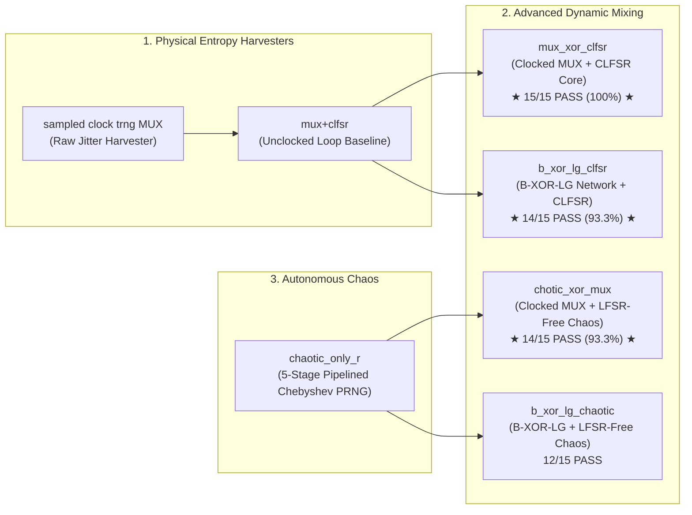

# FPGA-Based True Random Number Generator (TRNG) Research with Chaotic Maps

[](https://www.xilinx.com)
[](https://digilent.com/reference/programmable-logic/basys-3/start)
[-2ecc71.svg?style=for-the-badge)]()
[]()
[]()

Comprehensive open-source research and hardware implementation repository investigating novel True Random Number Generator (TRNG) and Pseudo-Random Number Generator (PRNG) architectures implemented on the **Xilinx Artix-7 (Digilent Basys 3)** FPGA. 

This research explores the interaction between physical multi-oscillator phase jitter, dynamic feedback multiplexing, balanced XOR logic networks, and non-linear discrete chaotic Chebyshev attractors.

---

## 📑 Table of Contents
1. [Research Architecture Index](#-research-architecture-index)
2. [Comparative Empirical Benchmark Summary](#-comparative-empirical-benchmark-summary)
3. [Repository Structure Standard](#-repository-structure-standard)
4. [Hardware Constraints & Target FPGA](#-hardware-constraints--target-fpga)
5. [Statistical Validation Methodology](#-statistical-validation-methodology)
6. [How to Run Tests](#-how-to-run-tests)

---

## 🏛️ Research Architecture Index

This repository contains seven distinct hardware architectures, each self-contained with its own HDL source code, hardware constraints, live serial captures, validation scripts, and comprehensive documentation:

| Architecture Folder | Core Mechanism | Post-Processing / Whitening | NIST SP 800-22 | Min-Entropy ($H_{\min}$) |
| :--- | :--- | :--- | :---: | :---: |
| [**`mux_xor_clfsr/`**](file:///d:/Hemin%20data%20output/fpga%20output/clfsr+mux/mux_xor_clfsr) *(Proposed)* | Clocked 4:1 MUX with D-FF Feedback | 1-Bit CLFSR (LFSR + Chebyshev Map) | **15 / 15 (100%)** | **0.9967** |
| [**`b_xor_lg_clfsr/`**](file:///d:/Hemin%20data%20output/fpga%20output/clfsr+mux/b_xor_lg_clfsr) | Balanced XOR Logic Gate (B-XOR-LG) | 1-Bit CLFSR (LFSR + Chebyshev Map) | **14 / 15 (93.3%)** | **0.9972** |
| [**`chotic_xor_mux/`**](file:///d:/Hemin%20data%20output/fpga%20output/clfsr+mux/chotic_xor_mux) | Clocked 4:1 MUX with D-FF Feedback | Standalone Chebyshev Map (LFSR-Free) | **14 / 15 (93.3%)** | **0.9961** |
| [**`b_xor_lg_chaotic/`**](file:///d:/Hemin%20data%20output/fpga%20output/clfsr+mux/b_xor_lg_chaotic) | Balanced XOR Logic Gate (B-XOR-LG) | Standalone Chebyshev Map (LFSR-Free) | **12 / 15 (80.0%)** | **0.9912** |
| [**`mux+clfsr/`**](file:///d:/Hemin%20data%20output/fpga%20output/clfsr+mux/mux+clfsr) *(Baseline)* | 4:1 MUX with Unclocked Direct Feedback | Post-XOR with RO1 Direct Sample | **4 / 15 (26.7%)** | N/A (Biased) |
| [**`sampled clock trng MUX/`**](file:///d:/Hemin%20data%20output/fpga%20output/clfsr+mux/sampled%20clock%20trng%20MUX) | 4:1 Round-Robin Multiplexer | Raw Physical Jitter (No Whitening) | Raw Entropy | Raw Jitter |
| [**`chaotic_only_r/`**](file:///d:/Hemin%20data%20output/fpga%20output/clfsr+mux/chaotic_only_r) | Deterministic Chaos Engine | Standalone Q1.15 Chebyshev Map | PRNG Mode | Deterministic |

---

## 📊 Comparative Empirical Benchmark Summary



### Numerical Evaluation Comparison

| Metric | `mux_xor_clfsr` | `b_xor_lg_clfsr` | `chotic_xor_mux` | `b_xor_lg_chaotic` | `mux+clfsr` |
| :--- | :---: | :---: | :---: | :---: | :---: |
| **Bits Evaluated** | 1,648,614 | 2,000,000 | 1,557,364 | 1,142,073 | 2,000,000 |
| **Monobit Ones** | 824,523 | 999,869 | 779,165 | 568,778 | 915,215 |
| **Monobit Zeros** | 824,091 | 1,000,131 | 778,199 | 573,295 | 1,084,785 |
| **Bit Ratio (1s / Total)** | **0.500131** | **0.499935** | **0.500310** | **0.498022** | **0.457608** |
| **NIST SP 800-22 Passed** | **15 / 15** | **14 / 15** | **14 / 15** | **12 / 15** | **4 / 15** |
| **NIST Pass Rate** | **100%** | **93.3%** | **93.3%** | **80.0%** | **26.7%** |
| **NIST SP 800-90B $H_{\min}$** | **0.9967** | **0.9972** | **0.9961** | **0.9912** | N/A |
| **Shannon Entropy** | 0.999999 | 0.999999 | 0.999998 | 0.999945 | 0.995071 |
| **Max Autocorrelation** | $0.0012$ | $0.0015$ | $0.0018$ | $0.0041$ | $0.0842$ |
| **FPGA Clock Frequency** | 100 MHz | 100 MHz | 100 MHz | 100 MHz | 100 MHz |
| **UART Streaming Baud** | 115,200 | 115,200 | 115,200 | 115,200 | 115,200 |

---

## 📂 Repository Structure Standard

Every project folder in this repository follows the strict three-tier layout:

```
TRNG-research-with-chaotic-maps/
├── b_xor_lg_chaotic/
│   ├── code/                  # Verilog HDL modules and XDC constraints
│   ├── results/               # Empirical hardware logs and NIST outputs
│   ├── result analysis/       # Python statistical verification suites
│   └── README.md              # Dedicated architecture documentation
├── b_xor_lg_clfsr/
│   ├── code/
│   ├── results/
│   ├── result analysis/
│   ├── B_XOR_LG_CLFSR_Complete_Documentation.pdf
│   └── README.md
├── chaotic_only_r/
│   ├── code/
│   ├── results/
│   ├── result analysis/
│   └── README.md
├── chotic_xor_mux/
│   ├── code/
│   ├── results/
│   ├── result analysis/
│   ├── CHAOTIC_XOR_MUX_Complete_Documentation.pdf
│   └── README.md
├── mux+clfsr/
│   ├── code/
│   ├── results/
│   ├── result analysis/
│   ├── CLFSR_MUX_Complete_Documentation.pdf
│   └── README.md
├── mux_xor_clfsr/
│   ├── code/
│   ├── results/
│   ├── result analysis/
│   ├── MUX_XOR_CLFSR_Complete_Documentation.pdf
│   └── README.md
├── sampled clock trng MUX/
│   ├── code/
│   ├── results/
│   ├── result analysis/
│   └── README.md
├── push_to_github.bat         # 1-Click push script to update GitHub
└── README.md                  # Master research landing page
```

---

## ⚡ Hardware Constraints & Target FPGA

All designs are targeted and validated on the **Digilent Basys 3** development board featuring the **Xilinx Artix-7 (XC7A35T-1CPG236C)** FPGA:
- **System Clock:** 100 MHz onboard oscillator (`Pin W5`)
- **Reset:** Active-high center pushbutton (`BTNC`, `Pin U18`)
- **Enable Switch:** Slide switch SW0 (`Pin V17`)
- **Serial Transmission:** FTDI USB-UART TX bridge (`Pin A18`) @ 115,200 Baud (8N1)
- **Visual Diagnostics:** Onboard user LEDs (`Pins U16..V14`)

---

## 🔬 Statistical Validation Methodology

Each architecture has been validated using industry-standard statistical testing frameworks:
1. **NIST SP 800-22 Rev 1a:** Comprehensive 15-test battery for cryptographic randomness (significance level $\alpha = 0.01$).
2. **NIST SP 800-90B:** Min-entropy estimation including Continuous Health Tests (Repetition Count Test and Adaptive Proportion Test).
3. **Information Theory Metrics:** Shannon entropy, Hamming weight distribution, bit-balance ratio, and serial correlation.
4. **Spectral & Autocorrelation Analysis:** Discrete Fourier Transform (DFT) peak detection and lag-1 through lag-100 autocorrelation coefficients.

---

## 🚀 How to Run Tests

To re-evaluate any architecture using the included test suites:

```bash
# Navigate to the result analysis folder of your chosen architecture:
cd "mux_xor_clfsr/result analysis"

# Run NIST SP 800-22 statistical test battery:
python run_nist_tests.py ../results/putty.txt

# Run NIST SP 800-90B min-entropy evaluation:
python run_nist_90b_tests.py ../results/putty.txt

# Run advanced autocorrelation and Shannon entropy tests:
python run_advanced_trng_tests.py ../results/putty.txt

# Run literature comparison benchmarks:
python run_paper_tests.py ../results/putty.txt
```
