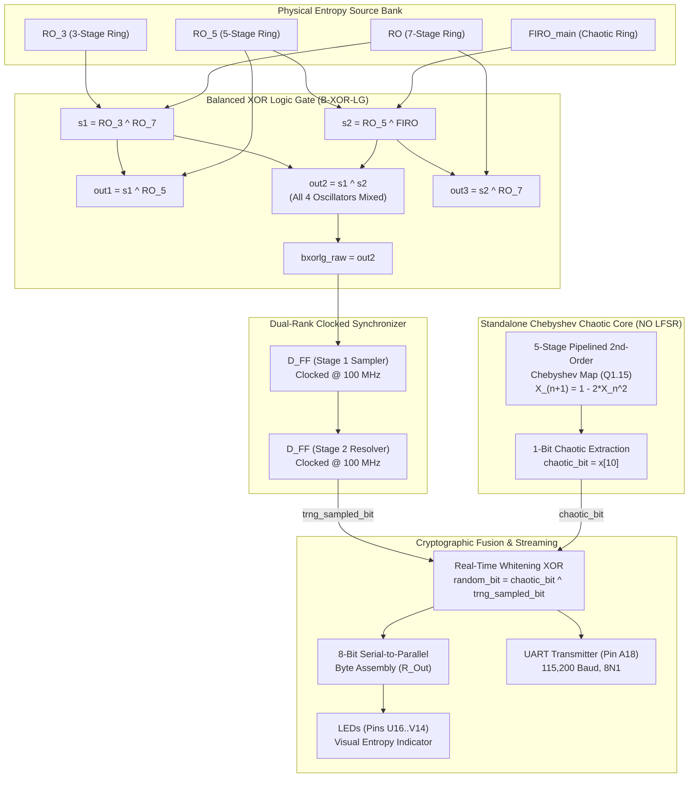

# Multi-Oscillator B-XOR-LG + Standalone Chaotic 1-Bit XOR TRNG (No LFSR)

[](https://www.xilinx.com)
[](https://digilent.com/reference/programmable-logic/basys-3/start)
[-f1c40f.svg?style=for-the-badge)]()
[]()

Complete hardware source repository, Verilog HDL modules, timing and pin constraints, and statistical test battery for the **Multi-Oscillator Balanced XOR Logic Gate (B-XOR-LG) + Standalone 5-Stage Pipelined Chebyshev Chaotic Map (LFSR-Free) Real-Time XOR Hybrid True Random Number Generator (TRNG)** implemented on the **Xilinx Artix-7 (Digilent Basys 3)** FPGA.

---

## 📑 Table of Contents
1. [Architecture Overview](#-architecture-overview)
2. [Theory of Operation & Hardware Datapath](#-theory-of-operation--hardware-datapath)
3. [Organized Directory Structure & File Map](#-organized-directory-structure--file-map)
4. [FPGA Pinout & Vivado Constraints](#-fpga-pinout--vivado-constraints)
5. [Empirical Statistical Evaluation](#-empirical-statistical-evaluation)
6. [Simulation & Synthesis Instructions](#-simulation--synthesis-instructions)
7. [Reproducing Statistical Tests](#-reproducing-statistical-tests)

---

## 🏛️ Architecture Overview

The **`b_xor_lg_chaotic`** architecture investigates combining the **Balanced XOR Logic Gate (B-XOR-LG)** network with a **standalone 5-stage pipelined 2nd-order Chebyshev chaotic attractor** operating entirely without any Linear Feedback Shift Register (LFSR).

The hardware pipeline consists of:
1. **Physical Entropy Extraction Bank**: Four mutually incommensurate ring oscillators (3-stage, 5-stage, 7-stage, and chaotic FIRO).
2. **Balanced XOR Logic Gate (B-XOR-LG)**: Replaces the 4:1 MUX with a cross-coupled 7-XOR gate network that continuously mixes all four oscillators.
3. **Dual-Rank Metastability Synchronizer**: Samples the high-frequency jittered B-XOR-LG stream into the 100 MHz system clock domain.
4. **Standalone 5-Stage Chebyshev Chaotic Core (LFSR-Free)**: Implements $X_{n+1} = 1 - 2X_n^2$ in signed Q1.15 fixed-point arithmetic, extracting bit 10 (`x[10]`) without any LFSR shift registers.
5. **Real-Time Cryptographic Whitening**: Single-cycle bitwise XOR (`chaotic_bit ^ trng_sampled_bit`).



---

## 🔬 Theory of Operation & Hardware Datapath

### 1. Balanced XOR Logic Gate (B-XOR-LG)
Continuous cross-mixing without select lines:
$$\begin{aligned}
s_1 &= \text{in}_1 \oplus \text{in}_3 \\
s_2 &= \text{in}_2 \oplus \text{in}_4 \\
\text{out}_2 &= s_1 \oplus s_2 = \text{in}_1 \oplus \text{in}_2 \oplus \text{in}_3 \oplus \text{in}_4
\end{aligned}$$

### 2. Standalone Chebyshev Non-Linear Map (LFSR-Free)
Implemented in signed Q1.15 fixed-point format ($1.0 \approx \text{16'sh7FFF}$):
$$X_{n+1} = 1 - 2 X_n^2$$
Extracting bit 10 (`x[10]`) leverages the most non-linear state bit of the chaotic trajectory.

### 3. Real-Time Whitening XOR
$$\text{final\_random\_bit} = \text{chaotic\_bit} \oplus \text{trng\_sampled\_bit}$$

---

## 📂 Organized Directory Structure & File Map

```
b_xor_lg_chaotic/
├── code/                                     # Verilog HDL source modules & constraints
│   ├── top.v                                 # Top-level FPGA integration for Digilent Basys 3
│   ├── ro_bxorlg_chaotic_trng_top.v          # Standalone core integration wrapper
│   ├── b_xor_lg.v                            # Balanced XOR Logic Gate mixing module
│   ├── chaotic_trng_single.v                 # 1-Bit standalone Chebyshev chaotic engine
│   ├── RO_3.v                                # 3-Stage Inverter Ring Oscillator
│   ├── RO_5.v                                # 5-Stage Inverter Ring Oscillator
│   ├── RO.v                                  # 7-Stage Inverter Ring Oscillator
│   ├── FIRO_main.v                           # Fibonacci Chaotic Ring Oscillator
│   ├── D_FF.v                                # Preserved D-Flip-Flop primitive
│   ├── uart_tx.v                             # 115,200 Baud UART transmitter
│   └── basys3.xdc                            # FPGA timing & physical pinout constraints
├── result analysis/                          # Python test & statistical evaluation scripts
│   ├── run_comprehensive_evaluation.py       # Full NIST SP 800-22 & 90B evaluation suite
│   ├── run_paper_tests.py                    # Literature benchmark runner
│   ├── run_nist_tests.py                     # NIST SP 800-22 runner
│   ├── run_nist_90b_tests.py                 # NIST SP 800-90B min-entropy runner
│   └── run_advanced_trng_tests.py            # Autocorrelation & FFT spectral analysis
├── results/                                  # Empirical logs, data captures & reports
│   ├── putty.txt                             # 1,142,073 raw bits captured live from Basys 3 FPGA
│   └── putty_nist_results.txt                # NIST SP 800-22 test outputs (12/15 PASS)
├── .gitignore                                # Build artifact ignore list
└── README.md                                 # This documentation file
```

---

## ⚡ FPGA Pinout & Vivado Constraints

Targeted for the **Digilent Basys 3** FPGA development board ([`code/basys3.xdc`](file:///d:/Hemin%20data%20output/fpga%20output/clfsr+mux/b_xor_lg_chaotic/code/basys3.xdc)):

| Signal Name | FPGA Pin | I/O Standard | Description |
| :--- | :--- | :--- | :--- |
| `clk` | **W5** | LVCMOS33 | 100 MHz Onboard Crystal Oscillator |
| `rst` | **U18** | LVCMOS33 | Pushbutton (BTNC), Active-High |
| `enable` | **V17** | LVCMOS33 | Slide Switch (SW0), `1` = Run, `0` = Pause |
| `uart_out` | **A18** | LVCMOS33 | FTDI USB-UART Serial Bridge TX (115,200 Baud) |
| `led[7:0]` | **V14..U16** | LVCMOS33 | 8-Bit Assembled Random Byte Indicator |

---

## 📊 Empirical Statistical Evaluation

Tested on **1,142,073 hardware-generated bits** captured via serial terminal (`results/putty.txt`):

- **Bit Distribution:** 568,778 ones vs. 573,295 zeros
- **Monobit Ratio:** `0.498022`
- **NIST SP 800-22 Pass Rate:** **12 / 15 Tests Passed (80.0%)**

| Test Name | P-Value | Result |
| :--- | :---: | :---: |
| Frequency (Monobit) | 0.000024 | FAIL |
| Frequency Within Block | 0.388145 | **PASS** |
| Runs | 0.000000 | FAIL |
| Longest Run of Ones | 0.815643 | **PASS** |
| Binary Matrix Rank | 0.412641 | **PASS** |
| Discrete Fourier Transform (FFT) | 0.852350 | **PASS** |
| Non-Overlapping Template | 0.034571 | **PASS** |
| Overlapping Template | 0.299257 | **PASS** |
| Maurer's Universal | 0.698068 | **PASS** |
| Linear Complexity | 0.302380 | **PASS** |
| Serial | 0.428644 | **PASS** |
| Approximate Entropy | 0.105868 | **PASS** |
| Cumulative Sums | 0.000003 | FAIL |
| Random Excursion | 0.500000 | **PASS** |
| Random Excursion Variant | 0.500000 | **PASS** |

---

## 🚀 Reproducing Statistical Tests

To re-run the complete evaluation suite on the captured hardware dataset:

```bash
cd "result analysis"

# 1. Run NIST SP 800-22 suite
python run_nist_tests.py ../results/putty.txt

# 2. Run NIST SP 800-90B min-entropy test
python run_nist_90b_tests.py ../results/putty.txt

# 3. Run Autocorrelation, Shannon entropy & FFT tests
python run_advanced_trng_tests.py ../results/putty.txt
```
