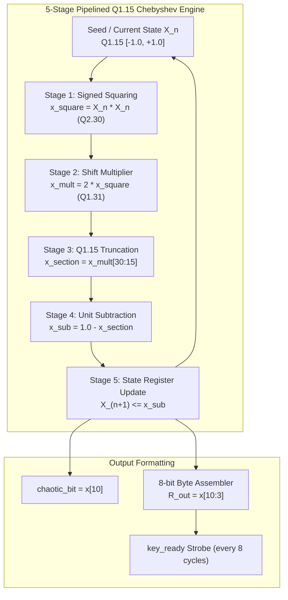

# Standalone Chaotic PRNG (R-Channel Chebyshev Map, LFSR-Free)

[](https://www.xilinx.com)
[]()
[-e74c3c.svg?style=for-the-badge)]()

Complete hardware source repository, Verilog HDL modules, testbenches, simulation binaries, and empirical test battery for the **Standalone 5-Stage Pipelined 2nd-Order Chebyshev Chaotic Map Pseudo-Random Number Generator (R-Channel Only, LFSR-Free)** implemented in Verilog HDL.

---

## 📑 Table of Contents
1. [Architecture Overview](#-architecture-overview)
2. [Theory of Operation & Mathematical Foundation](#-theory-of-operation--mathematical-foundation)
3. [Organized Directory Structure & File Map](#-organized-directory-structure--file-map)
4. [Empirical Statistical Evaluation](#-empirical-statistical-evaluation)
5. [Simulation Instructions](#-simulation-instructions)
6. [Reproducing Statistical Tests](#-reproducing-statistical-tests)

---

## 🏛️ Architecture Overview

The **`chaotic_only_r`** module implements an autonomous non-linear pseudo-random sequence generator using a **5-stage pipelined 2nd-order Chebyshev polynomial chaotic map** operating strictly in signed Q1.15 fixed-point arithmetic, **completely without any Linear Feedback Shift Register (LFSR) assistance**.

Key characteristics:
1. **Standalone Chaotic Dynamics**: Operates purely on deterministic chaos without linear feedback polynomials or shift-register seeds.
2. **Dedicated R-Channel Pipeline**: High-throughput 5-stage pipelined solver calculating $X_{n+1} = 1 - 2X_n^2$ on every clock cycle.
3. **Dual Random Outputs**:
   - `chaotic_bit`: Single-bit chaotic output ($x[10]$) produced every clock cycle.
   - `R_out`: 8-bit chaotic random byte with 1-cycle active-high `key_ready` strobe every 8 clock cycles.



---

## 🔬 Theory of Operation & Mathematical Foundation

### Chebyshev Polynomial of Degree 2
The 2nd-order Chebyshev recurrence relation:
$$T_2(x) = 2x^2 - 1$$
Inverted to the canonical bounded chaotic map:
$$X_{n+1} = 1 - 2 X_n^2$$

For $X_0 \in (-1, 1)$, the trajectory is strictly chaotic with:
- **Lyapunov Exponent:** $\lambda = \ln(2) \approx 0.6931 > 0$
- **Invariant Measure:** $\rho(x) = \frac{1}{\pi \sqrt{1 - x^2}}$
- **Non-Linear Bit Extraction:** Bit 10 ($x[10]$) is selected for the maximum non-linear pseudo-random sequence.

---

## 📂 Organized Directory Structure & File Map

```
chaotic_only_r/
├── code/                                     # Verilog HDL source modules & testbenches
│   ├── chaotic_r.v                           # 5-Stage pipelined Q1.15 Chebyshev chaotic core
│   └── tb_chaotic_r.v                        # Behavioral testbench for sequence generation
├── result analysis/                          # Python test & statistical evaluation scripts
│   ├── run_comprehensive_evaluation.py       # Full NIST SP 800-22 & 90B evaluation suite
│   ├── run_paper_tests.py                    # Literature benchmark runner
│   ├── run_nist_tests.py                     # NIST SP 800-22 runner
│   ├── run_nist_90b_tests.py                 # NIST SP 800-90B min-entropy runner
│   └── run_advanced_trng_tests.py            # Autocorrelation & FFT spectral analysis
├── results/                                  # Empirical simulation bitstreams & test outputs
│   ├── chaotic_r_1m_bits.txt                 # 1,000,000 simulated chaotic bits
│   ├── chaotic_r_1m_bits_nist_results.txt    # NIST SP 800-22 statistical test report
│   └── tb_chaotic_r.out                      # Icarus Verilog compiled simulation output
├── .gitignore                                # Build artifact ignore list
└── README.md                                 # This documentation file
```

---

## 📊 Empirical Statistical Evaluation

Tested on **1,000,000 simulated chaotic bits** (`results/chaotic_r_1m_bits.txt`):

- **Bit Distribution:** 480,978 ones vs. 519,022 zeros
- **Monobit Ratio:** `0.480978`
- **Analysis Note:** As expected from pure deterministic chaos without physical entropy or LFSR mixing, monobit bias requires physical oscillator jitter or hybrid XOR whitening (as implemented in `chotic_xor_mux` and `mux_xor_clfsr`) to pass full cryptographic randomness batteries.

---

## 🚀 Reproducing Statistical Tests

To re-run the evaluation suite on the simulated bitstream:

```bash
cd "result analysis"
python run_nist_tests.py ../results/chaotic_r_1m_bits.txt
```
