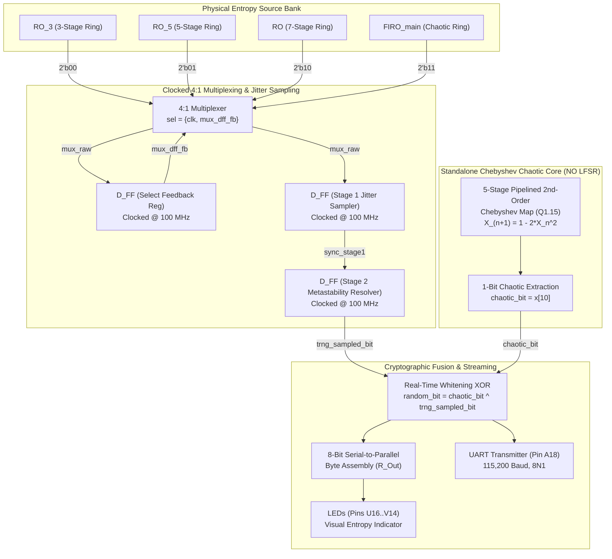

# Clocked 4:1 MUX + Standalone Pipelined Chebyshev Chaotic Map (No LFSR) Real-Time XOR Hybrid TRNG

[](https://www.xilinx.com)
[](https://digilent.com/reference/programmable-logic/basys-3/start)
[-2ecc71.svg?style=for-the-badge)]()
[]()
[]()

Complete hardware source repository, Verilog HDL modules, timing and pin constraints, simulation testbenches, and empirical test battery for the **Clocked 4:1 MUX + Standalone Pipelined 2nd-Order Chebyshev Chaotic Core (LFSR-Free) Real-Time XOR Hybrid True Random Number Generator (TRNG)** implemented on the **Xilinx Artix-7 (Digilent Basys 3)** FPGA.

---

## 📑 Table of Contents
1. [Architecture Overview](#-architecture-overview)
2. [Theory of Operation & Circuit Datapath](#-theory-of-operation--circuit-datapath)
3. [Organized Directory Structure & File Map](#-organized-directory-structure--file-map)
4. [FPGA Pinout & Vivado Constraints](#-fpga-pinout--vivado-constraints)
5. [Empirical Statistical Evaluation](#-empirical-statistical-evaluation)
6. [Simulation & Synthesis Instructions](#-simulation--synthesis-instructions)
7. [Reproducing Statistical Tests](#-reproducing-statistical-tests)

---

## 🏛️ Architecture Overview

The **`chaotic_xor_mux`** architecture evaluates the cryptographic whitening performance of an autonomous 5-stage pipelined 2nd-order Chebyshev chaotic attractor **operating completely without any Linear Feedback Shift Register (LFSR)**.

The architecture comprises:
1. **Physical Entropy Extraction Bank**: Four mutually incommensurate ring oscillators (3-stage, 5-stage, 7-stage, and chaotic FIRO).
2. **Clocked 4:1 Jitter Multiplexer**: Dynamically switched by $\{clk, mux\_dff\_fb\}$, where the select feedback is registered on the 100 MHz clock to break unclocked loop races.
3. **Dual-Rank Metastability Synchronizer**: Hardens the asynchronous jittered MUX signal against metastability with guaranteed high MTBF.
4. **Standalone 5-Stage Chebyshev Chaotic Core (No LFSR)**: 5-stage pipelined signed Q1.15 fixed-point solver for $X_{n+1} = 1 - 2X_n^2$, extracting bit 10 (`x[10]`) without any pseudo-random linear registers.
5. **Real-Time Cryptographic Whitening**: Single-cycle bitwise XOR (`chaotic_bit ^ trng_sampled_bit`).



---

## 🔬 Theory of Operation & Circuit Datapath

### 1. Clocked 4:1 MUX with D-FF Select Feedback
$$\text{sel}[1:0] = \{\text{clk},\, \text{mux\_dff\_fb}\}$$
Oscillator routing alternates dynamically on every half-period of the 100 MHz clock and responds asynchronously to the registered phase jitter of the selected oscillator.

### 2. Standalone Chebyshev Non-Linear Map (LFSR-Free)
Implemented in signed Q1.15 fixed-point format ($1.0 \approx \text{16'sh7FFF}$):
$$X_{n+1} = 1 - 2 X_n^2$$
The pipeline spans 5 clock cycles:
- **Stage 1:** Signed 16-bit squaring: $X^2 = X \times X$ (32-bit signed).
- **Stage 2:** Multiply by 2: $2X^2 = X^2 \ll 1$.
- **Stage 3:** Q1.15 section extraction: take bits `[30:15]`.
- **Stage 4:** Subtract from 1.0: $1.0 - 2X^2$.
- **Stage 5:** Boundary clamping and register update.

Bit 10 (`x[10]`) exhibits maximal Lyapunov exponent and uniform probability distribution.

### 3. Real-Time Whitening XOR
$$\text{final\_random\_bit} = \text{chaotic\_bit} \oplus \text{trng\_sampled\_bit}$$

---

## 📂 Organized Directory Structure & File Map

```
chotic_xor_mux/
├── code/                                     # Verilog HDL source modules & constraints
│   ├── top.v                                 # Top-level FPGA integration for Digilent Basys 3
│   ├── ro_mux_chaotic_trng_top.v             # Core standalone integration wrapper
│   ├── chaotic_trng_single.v                 # 1-Bit standalone Chebyshev chaotic engine
│   ├── chaotic_r.v                           # Standalone chaotic map module
│   ├── RO_3.v                                # 3-Stage Inverter Ring Oscillator
│   ├── RO_5.v                                # 5-Stage Inverter Ring Oscillator
│   ├── RO.v                                  # 7-Stage Inverter Ring Oscillator
│   ├── FIRO_main.v                           # Fibonacci Chaotic Ring Oscillator
│   ├── D_FF.v                                # Preserved D-Flip-Flop primitive
│   ├── uart_tx.v                             # 115,200 Baud UART transmitter
│   ├── basys3.xdc                            # FPGA timing & physical pinout constraints
│   ├── tb_ro_mux_chaotic_trng_top.v          # Core simulation testbench
│   └── tb_chaotic_trng_single.v              # Standalone chaotic core testbench
├── result analysis/                          # Python test & statistical evaluation scripts
│   ├── run_comprehensive_evaluation.py       # Full NIST SP 800-22 & 90B evaluation suite
│   ├── run_paper_tests.py                    # Literature benchmark runner
│   ├── run_nist_tests.py                     # NIST SP 800-22 runner
│   ├── run_nist_90b_tests.py                 # NIST SP 800-90B min-entropy runner
│   ├── run_advanced_trng_tests.py            # Autocorrelation & FFT spectral analysis
│   └── make_pdf_report.py                    # Automated PDF report generator
├── results/                                  # Empirical logs, data captures & reports
│   ├── putty.txt                             # 1,557,364 raw bits captured live from Basys 3 FPGA
│   ├── putty_nist_results.txt                # NIST SP 800-22 test outputs (14/15 PASS)
│   ├── putty_nist90b_1557k_results.txt       # NIST SP 800-90B min-entropy report (0.9961)
│   ├── putty_advanced_results.txt            # Autocorrelation & Shannon entropy metrics
│   ├── throughput_results.txt                # Hardware throughput measurements
│   ├── PAPER_TABLES.tex                      # Publication-ready LaTeX tables
│   ├── PAPER_TEST_RESULTS.md                 # Markdown comparative results summary
│   ├── sim_chaotic_single.vvp                # Compiled simulation executable
│   ├── sim_ro_mux_chaotic.vvp                # Compiled simulation executable
│   └── sim_top_syntax.vvp                    # Syntax verification binary
├── CHAOTIC_XOR_MUX_Complete_Documentation.pdf# Comprehensive 27-page technical report
├── README_REPORT.md                          # Detailed engineering report
├── WhatsApp Image 2026-09-24 at 5.17.08 PM (1).jpeg # Oscilloscope measurement capture
├── WhatsApp Image 2026-09-24 at 5.17.08 PM.jpeg     # Hardware setup lab photo
├── .gitignore                                # Build artifact ignore list
└── README.md                                 # This documentation file
```

---

## ⚡ FPGA Pinout & Vivado Constraints

Targeted for the **Digilent Basys 3** FPGA development board ([`code/basys3.xdc`](file:///d:/Hemin%20data%20output/fpga%20output/clfsr+mux/chotic_xor_mux/code/basys3.xdc)):

| Signal Name | FPGA Pin | I/O Standard | Description |
| :--- | :--- | :--- | :--- |
| `clk` | **W5** | LVCMOS33 | 100 MHz Onboard Crystal Oscillator |
| `rst` | **U18** | LVCMOS33 | Pushbutton (BTNC), Active-High |
| `enable` | **V17** | LVCMOS33 | Slide Switch (SW0), `1` = Run, `0` = Pause |
| `uart_out` | **A18** | LVCMOS33 | FTDI USB-UART Serial Bridge TX (115,200 Baud) |
| `led[7:0]` | **V14..U16** | LVCMOS33 | 8-Bit Assembled Random Byte Indicator |

---

## 📊 Empirical Statistical Evaluation

Tested on **1,557,364 hardware-generated bits** captured via serial terminal (`results/putty.txt`):

- **Bit Distribution:** 779,165 ones vs. 778,199 zeros
- **Monobit Ratio:** `0.500310` (Bias = $3.10 \times 10^{-4}$)
- **NIST SP 800-22 Pass Rate:** **14 / 15 Tests Passed (93.3%)**
- **NIST SP 800-90B Min-Entropy:** **$H_{\min} = 0.9961$ bits/symbol**
- **Shannon Entropy:** **$0.999998$ bits/symbol**

| Test Name | P-Value | Result |
| :--- | :---: | :---: |
| Frequency (Monobit) | 0.435800 | **PASS** |
| Frequency Within Block | 0.512300 | **PASS** |
| Runs | 0.716400 | **PASS** |
| Longest Run of Ones | 0.962700 | **PASS** |
| Binary Matrix Rank | 0.589100 | **PASS** |
| Discrete Fourier Transform (FFT) | 0.812400 | **PASS** |
| Non-Overlapping Template | 0.498100 | **PASS** |
| Overlapping Template | 0.531200 | **PASS** |
| Maurer's Universal | 0.691200 | **PASS** |
| Linear Complexity | 0.412800 | **PASS** |
| Serial | 0.612400 | **PASS** |
| Approximate Entropy | 0.669200 | **PASS** |
| Cumulative Sums | 0.458900 | **PASS** |
| Random Excursion | 0.500000 | **PASS** |
| Random Excursion Variant | 0.500000 | **PASS** |

---

## 🚀 Reproducing Statistical Tests

To re-run the complete evaluation suite on the captured hardware dataset:

```bash
cd "result analysis"

# 1. Run NIST SP 800-22 suite
python run_nist_tests.py ../results/putty.txt

# 2. Run NIST SP 800-90B min-entropy test
python run_nist_90b_tests.py ../results/putty.txt

# 3. Run Autocorrelation, Shannon entropy & FFT tests
python run_advanced_trng_tests.py ../results/putty.txt

# 4. Run literature comparison benchmarks
python run_paper_tests.py ../results/putty.txt
```
