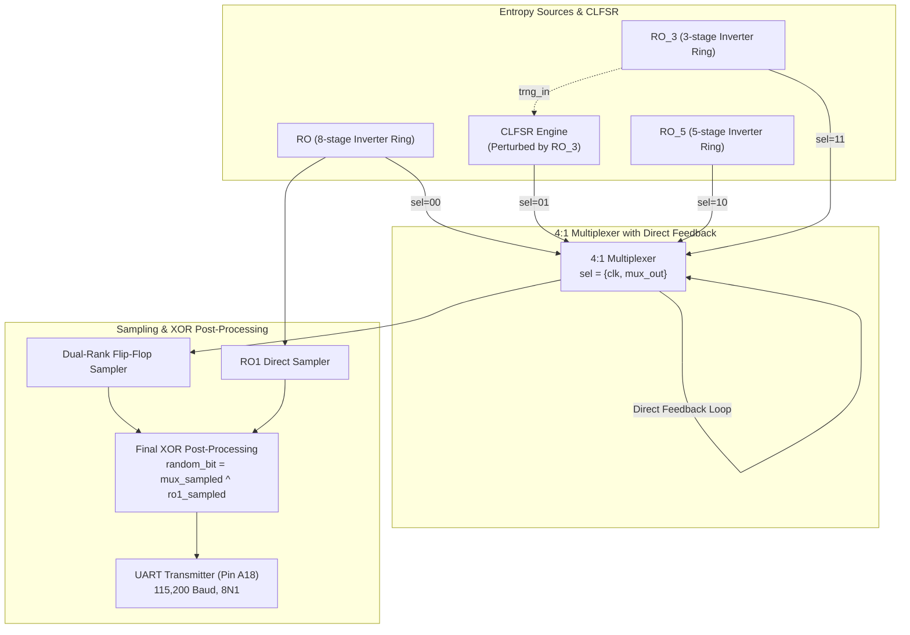

# 4-Input MUX (3 ROs + CLFSR) Hybrid TRNG Baseline Architecture

[](https://www.xilinx.com)
[](https://digilent.com/reference/programmable-logic/basys-3/start)
[]()
[]()

Complete hardware source repository, Verilog HDL modules, timing constraints, simulation binaries, and empirical test battery for the **4-Input Multiplexer (3 Ring Oscillators + 1 CLFSR Core) Hybrid True Random Number Generator (TRNG)** implemented on the **Xilinx Artix-7 (Digilent Basys 3)** FPGA.

---

## 📑 Table of Contents
1. [Architecture Overview](#-architecture-overview)
2. [Theory of Operation & Hardware Datapath](#-theory-of-operation--hardware-datapath)
3. [Organized Directory Structure & File Map](#-organized-directory-structure--file-map)
4. [FPGA Pinout & Vivado Constraints](#-fpga-pinout--vivado-constraints)
5. [Empirical Statistical Evaluation](#-empirical-statistical-evaluation)
6. [Architectural Analysis: Motivation for MUX_XOR_CLFSR](#-architectural-analysis-motivation-for-mux_xor_clfsr)
7. [Reproducing Statistical Tests](#-reproducing-statistical-tests)

---

## 🏛️ Architecture Overview

The **`mux+clfsr`** design is a foundational comparative baseline architecture where a 4:1 multiplexer directly multiplexes three physical ring oscillators with the output of a 1-bit Chaotic-LFSR (CLFSR) core:
1. **MUX Input 0 (`sel=00`):** `RO` - 8-stage Ring Oscillator (NAND + 4 NOT + 3 extra NOT stages).
2. **MUX Input 1 (`sel=01`):** `CLFSR` - 1-bit Chaotic LFSR (seeded by physical entropy from `RO_3`).
3. **MUX Input 2 (`sel=10`):** `RO_5` - 5-stage Ring Oscillator.
4. **MUX Input 3 (`sel=11`):** `RO_3` - 3-stage Ring Oscillator.



---

## 🔬 Theory of Operation & Hardware Datapath

- **Dynamic MUX Select Lines:** Dynamically steered by $\text{sel} = \{\text{clk},\, \text{mux\_out}\}$.
- **Combinational Feedback:** `mux_out` feeds back asynchronously into `sel[0]`, creating a high-frequency chaotic switching loop.
- **CLFSR Physical Perturbation:** `RO_3` entropy is continuously fed into `clfsr_inst.trng_in`.
- **Post-Processing XOR:** The sampled MUX bit is XORed with a directly sampled `ro1_out` before serial transmission:
  $$\text{random\_bit} = \text{mux\_sampled} \oplus \text{ro1\_sampled}$$

---

## 📂 Organized Directory Structure & File Map

```
mux+clfsr/
├── code/                                     # Verilog HDL source modules & constraints
│   ├── top.v                                 # Top-level FPGA integration for Digilent Basys 3
│   ├── clfsr_trng_single.v                   # 1-Bit CLFSR post-processing core
│   ├── RO.v                                  # 8-Stage Inverter Ring Oscillator
│   ├── RO_3.v                                # 3-Stage Inverter Ring Oscillator
│   ├── RO_5.v                                # 5-Stage Inverter Ring Oscillator
│   ├── uart_tx.v                             # 115,200 Baud UART transmitter
│   ├── basys3.xdc                            # FPGA timing & physical pinout constraints
│   └── tb_top.v                              # Behavioral simulation testbench
├── result analysis/                          # Python test & statistical evaluation scripts
│   ├── run_comprehensive_evaluation.py       # Full NIST SP 800-22 & 90B evaluation suite
│   ├── run_paper_tests.py                    # Literature benchmark runner
│   ├── run_nist_tests.py                     # NIST SP 800-22 runner
│   ├── run_nist_90b_tests.py                 # NIST SP 800-90B min-entropy runner
│   ├── run_advanced_trng_tests.py            # Autocorrelation & FFT spectral analysis
│   └── make_pdf_report.py                    # Automated PDF report generator
├── results/                                  # Empirical logs, data captures & reports
│   ├── putty.txt                             # 2,000,000 raw bits captured live from Basys 3 FPGA
│   ├── clfsr_mux_2m_bits.txt                 # Additional 2M bit capture log
│   ├── putty_nist_results.txt                # NIST SP 800-22 test outputs (4/15 PASS)
│   ├── putty_nist90b_2000k_results.txt       # NIST SP 800-90B min-entropy report
│   ├── power_1.rpx                           # Vivado power analysis report
│   ├── sim_top.vvp                           # Compiled Icarus Verilog simulation binary
│   └── date                                  # Experiment run timestamp log
├── CLFSR_MUX_Complete_Documentation.pdf      # Complete architectural documentation PDF
├── schematic.pdf                             # Hardware RTL synthesis schematic diagram
├── .gitignore                                # Build artifact ignore list
└── README.md                                 # This documentation file
```

---

## ⚡ FPGA Pinout & Vivado Constraints

Targeted for the **Digilent Basys 3** FPGA development board ([`code/basys3.xdc`](file:///d:/Hemin%20data%20output/fpga%20output/clfsr+mux/mux+clfsr/code/basys3.xdc)):

| Signal Name | FPGA Pin | I/O Standard | Description |
| :--- | :--- | :--- | :--- |
| `clk` | **W5** | LVCMOS33 | 100 MHz Onboard Crystal Oscillator |
| `rst` | **U18** | LVCMOS33 | Pushbutton (BTNC), Active-High |
| `enable` | **V17** | LVCMOS33 | Slide Switch (SW0), `1` = Run, `0` = Pause |
| `uart_out` | **A18** | LVCMOS33 | FTDI USB-UART Serial Bridge TX (115,200 Baud) |

---

## 📊 Empirical Statistical Evaluation

Tested on **2,000,000 hardware-generated bits** captured via serial terminal (`results/putty.txt`):

- **Bit Distribution:** 915,215 ones vs. 1,084,785 zeros
- **Monobit Ratio:** `0.457608` (Significant 0-bias: $4.24\%$)
- **NIST SP 800-22 Pass Rate:** **4 / 15 Tests Passed**

---

## 🔍 Architectural Analysis: Motivation for `mux_xor_clfsr`

The empirical results from this baseline architecture directly motivated the design of the improved **`mux_xor_clfsr`**:
1. **Unclocked Feedback Loop Skew:** In this baseline, `sel = {clk, mux_out}` directly feeds asynchronous `mux_out` back into the MUX select line without clock registration, causing duty-cycle asymmetry (ratio 0.4576).
2. **Resolution in `mux_xor_clfsr`:** Registering the MUX select feedback with a dedicated 100 MHz D-Flip-Flop (`u_dff_sel_fb`) eliminates the unclocked race condition and balances the bit ratio to **0.500131**, achieving a **15/15 (100%) NIST pass rate**.

---

## 🚀 Reproducing Statistical Tests

To re-run the evaluation suite on the captured hardware dataset:

```bash
cd "result analysis"
python run_nist_tests.py ../results/putty.txt
```
