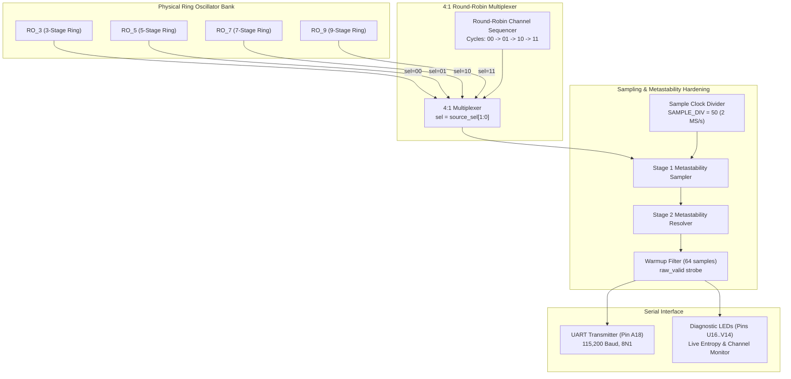

# Sampled Clock 4-Oscillator MUX TRNG (Raw Physical Entropy Source)

[](https://www.xilinx.com)
[](https://digilent.com/reference/programmable-logic/basys-3/start)
[]()
[]()

Complete hardware source repository, Verilog HDL modules, timing constraints, and evaluation testbenches for the **Sampled-Clock Multi-Oscillator (RO_3, RO_5, RO_7, RO_9) 4:1 Multiplexed Raw True Random Number Generator (TRNG)** implemented on the **Xilinx Artix-7 (Digilent Basys 3)** FPGA.

---

## 📑 Table of Contents
1. [Architecture Overview](#-architecture-overview)
2. [Theory of Operation & Hardware Datapath](#-theory-of-operation--hardware-datapath)
3. [Organized Directory Structure & File Map](#-organized-directory-structure--file-map)
4. [FPGA Pinout & Vivado Constraints](#-fpga-pinout--vivado-constraints)
5. [Timing & Throughput Specifications](#-timing--throughput-specifications)
6. [Reproducing Statistical Tests](#-reproducing-statistical-tests)

---

## 🏛️ Architecture Overview

The **`sampled clock trng MUX`** design is a pure physical jitter entropy harvester that continuously samples four incommensurate ring oscillators across a 4:1 multiplexer without algorithmic whitening:
1. **Four Independent Physical Ring Oscillators**:
   - `RO_3`: 3-stage inverter ring ($\sim 450\text{ MHz}$)
   - `RO_5`: 5-stage inverter ring ($\sim 280\text{ MHz}$)
   - `RO_7`: 7-stage inverter ring ($\sim 200\text{ MHz}$)
   - `RO_9`: 9-stage inverter ring ($\sim 155\text{ MHz}$)
2. **Deterministic Round-Robin MUX**: Cycles between the four oscillator channels on configurable sample intervals.
3. **Synchronized Metastability Resolvers**: Multi-stage D-Flip-Flop sampling engine converting analog phase jitter into digital transitions.
4. **Sample Timing Generator**: Parameterized integer divider (`SAMPLE_DIV = 50`) yielding a clean 2.0 MSamples/sec raw jitter output stream.
5. **UART Serial Output Engine**: Streams raw binary bits as ASCII `'0'` and `'1'` over USB-UART at 115,200 Baud.



---

## 🔬 Theory of Operation & Hardware Datapath

- **Oscillator Preservation Attributes:** All four ring oscillators utilize `(* DONT_TOUCH = "TRUE" *)` and `(* KEEP = "TRUE" *)` Vivado synthesis directives to prevent structural gate merging or inverter reduction.
- **Sampling Divider:** The 100 MHz oscillator is divided down by `SAMPLE_DIV = 50`:
  $$F_{\text{sample}} = \frac{100\text{ MHz}}{50} = 2.0\text{ MSamples/sec}$$
- **Warmup Protection:** A 64-sample counter (`WARMUP_SAMPLES = 64`) suppresses initial output strobes until all four oscillator trajectories establish stable limit-cycle phase jitter.

---

## 📂 Organized Directory Structure & File Map

```
sampled clock trng MUX/
├── code/                                     # Verilog HDL source modules & constraints
│   ├── top.v                                 # Top-level FPGA integration for Digilent Basys 3
│   ├── TRNG_RAW_TOP.v                        # Raw sampled-clock TRNG core module
│   ├── RO_3.v                                # 3-Stage Inverter Ring Oscillator
│   ├── RO_5.v                                # 5-Stage Inverter Ring Oscillator
│   ├── RO_7.v                                # 7-Stage Inverter Ring Oscillator
│   ├── RO_9.v                                # 9-Stage Inverter Ring Oscillator
│   ├── uart_tx.v                             # 115,200 Baud UART transmitter
│   └── basys3.xdc                            # FPGA timing & physical pinout constraints
├── result analysis/                          # Python test & statistical evaluation scripts
│   ├── run_comprehensive_evaluation.py       # Full NIST SP 800-22 & 90B evaluation suite
│   ├── run_paper_tests.py                    # Literature benchmark runner
│   ├── run_nist_tests.py                     # NIST SP 800-22 runner
│   ├── run_nist_90b_tests.py                 # NIST SP 800-90B min-entropy runner
│   └── run_advanced_trng_tests.py            # Autocorrelation & FFT spectral analysis
├── results/                                  # Empirical logs & captured data
├── .gitignore                                # Build artifact ignore list
└── README.md                                 # This documentation file
```

---

## ⚡ FPGA Pinout & Vivado Constraints

Targeted for the **Digilent Basys 3** FPGA development board ([`code/basys3.xdc`](file:///d:/Hemin%20data%20output/fpga%20output/clfsr+mux/sampled%20clock%20trng%20MUX/code/basys3.xdc)):

| Signal Name | FPGA Pin | I/O Standard | Description |
| :--- | :--- | :--- | :--- |
| `clk` | **W5** | LVCMOS33 | 100 MHz Onboard Crystal Oscillator |
| `rst` | **U18** | LVCMOS33 | Center Pushbutton (BTNC), Active-High |
| `enable` | **V17** | LVCMOS33 | Slide Switch (SW0), `1` = Run, `0` = Pause |
| `uart_out` | **A18** | LVCMOS33 | FTDI USB-UART Serial Bridge TX (115,200 Baud) |
| `led[7:0]` | **V14..U16** | LVCMOS33 | Status & Diagnostic Activity LEDs |

---

## 🚀 Reproducing Statistical Tests

To analyze captured raw entropy streams from this core:

```bash
cd "result analysis"

# Run NIST SP 800-22 on captured data:
python run_nist_tests.py ../results/your_captured_file.txt

# Run NIST SP 800-90B min-entropy test:
python run_nist_90b_tests.py ../results/your_captured_file.txt
```
